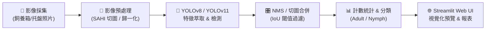

# 🪳 DubiaCount: Automated Dense Object Detection & Counting System

[](.gitlab-ci.yml)
[](https://www.python.org/)
[](https://docs.astral.sh/uv/)
[](LICENSE)
[](https://github.com/ultralytics/ultralytics)

> **DubiaCount** 是一套專門針對**高密度昆蟲群體（杜比亞蟑螂 *Blaptica dubia*）**所設計的自動化目標偵測與精準計數系統。本專案結合先進的 YOLO 偵測架構與 SAHI 切圖推論技術，解決養殖產業與生物實驗中「重疊遮擋、尺度落差大、底材雜訊」的傳統計數痛點。

---

## 📌 核心痛點與技術亮點

| 痛點 / 挑戰 | 影響 | 本專案解決策略 |
| :--- | :--- | :--- |
| **高密度重疊與遮擋 (Occlusion)** | 昆蟲習性群聚踩踏，傳統 NMS 容易過度抑制導致漏檢。 | 引入 **Soft-NMS** 與 **MixUp / Mosaic** 資料增強，提升局部特徵識別力。 |
| **極端多尺度 (Scale Variation)** | 初生若蟲（約 3-5mm）與成蟲（40-50mm）體積相差數十倍。 | 整合 **SAHI (Slicing Aided Hyper Inference)** 切圖技術，顯著提升微小目標召回率。 |
| **複雜背景與陰影雜訊** | 麥片、飼料底材及蛋盒陰影與若蟲顏色高度相似。 | 針對性光影旋轉增強（0~360°）、動態對比增強，強化邊緣特徵。 |
| **數量評估指標偏離** | 單純 mAP 無法直接衡量「庫存計數」商業誤差。 | 同步評估 **MAE (平均絕對誤差)**、**RMSE** 與 **MAPE** 作為核心計數標準。 |

---

## 🏗️ 系統架構 (ML Pipeline)



---

## 📂 專案目錄結構

```text
DubiaCount/
├── .gitlab/
│   └── issue_templates/       # GitLab 議題模板 (Bug Report, Feature Request)
├── .gitlab-ci.yml             # GitLab CI 自動化測試與 Linting
├── configs/
│   ├── data.yaml              # 資料集路徑配置 (YOLO 格式)
│   └── train_config.yaml      # 訓練超參數配置 (epochs, batch, augmentations)
├── src/
│   ├── dataset/               # 資料前處理與資料增強邏輯
│   ├── models/                # 模型訓練、評估與 SAHI 切圖推論
│   ├── app/                   # Streamlit 網頁互動式展示平台
│   └── utils/                 # MAE / RMSE 計數誤差指標計算
├── tests/                     # pytest 單元測試
├── weights/                   # 存放預訓練及微調權重 (best.pt)
├── Dockerfile                 # 容器化建置設定
├── pyproject.toml             # uv 套件與專案配置
└── README.md
```

---

## 🚀 快速上手 (Quick Start)

本專案採用現代化極速 Python 管理工具 [**uv**](https://docs.astral.sh/uv/)。

### 1. 安裝與同步環境

```bash
# 複製專案
git clone <your-gitlab-repo-url>
cd DubiaCount

# 使用 uv 一鍵安裝並同步虛擬環境
uv sync
```

### 2. 啟動互動式 Web 展示系統

```bash
uv run streamlit run src/app/app.py
```
> 開啟瀏覽器訪問 `http://localhost:8501`，即可上傳照片並動態調整信心度滑桿進行計數。

### 3. 執行模型訓練

```bash
uv run python src/models/train.py --config configs/train_config.yaml
```

### 4. 執行自動化測試

```bash
uv run pytest tests/ -v
```

---

## 📈 評估指標 (Counting Evaluation)

除了目標偵測標準指標（mAP@0.5、mAP@0.5:0.95），本專案以實際計數準確度為導向：

$$MAE = \frac{1}{N} \sum_{i=1}^N |y_i - \hat{y}_i|$$

$$RMSE = \sqrt{\frac{1}{N} \sum_{i=1}^N (y_i - \hat{y}_i)^2}$$

---

## 🐳 Docker 部署

```bash
# 建置 Docker 映像檔
docker build -t dubiacount:latest .

# 啟動容器服務
docker run -p 8501:8501 dubiacount:latest
```

---

## 🗺️ 開發路線圖 (Roadmap)

- [x] 專案基礎骨架、uv 環境與 GitLab CI 設定
- [x] 計數評估模組 (MAE / RMSE) 與 SAHI 切圖推論模組
- [x] Streamlit 互動式 Web UI 原型
- [ ] **Phase 1**: 收集並標註 100+ 張真實養殖箱照片 (Roboflow)
- [ ] **Phase 2**: YOLOv8n / YOLOv11 基準模型微調訓練
- [ ] **Phase 3**: 多類別擴展 (成蟲雄性、成蟲雌性、初生若蟲)
- [ ] **Phase 4**: GitLab Releases / Hugging Face 權重自動託管

---

## 📄 授權條款

本專案採用 [MIT License](LICENSE) 授權。
